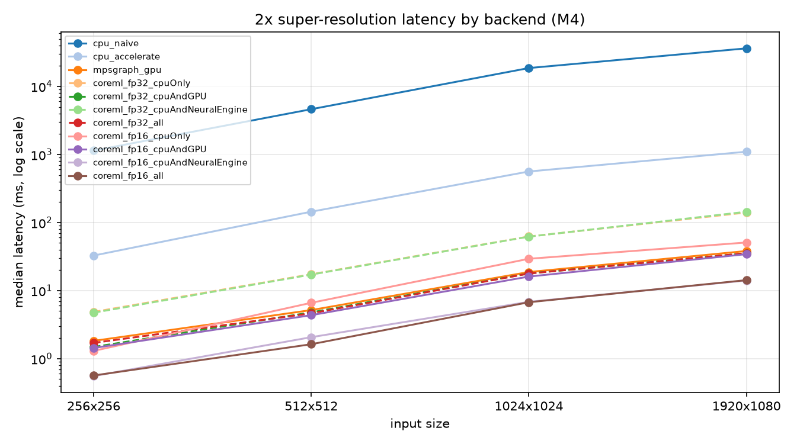
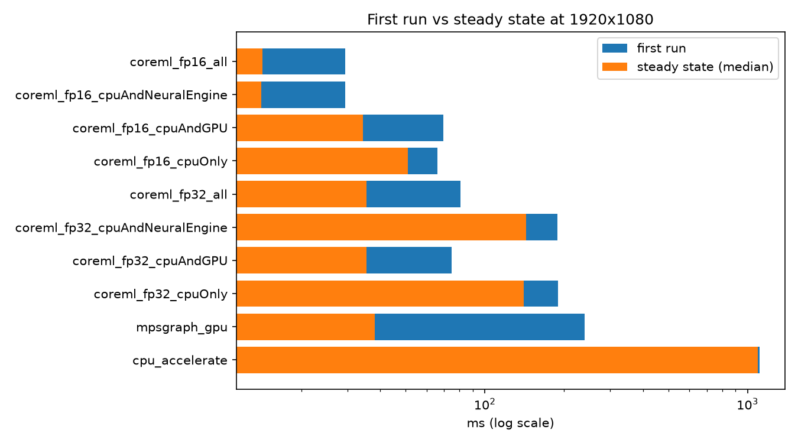

# Performance report: 2× super-resolution on Apple silicon

The goal here was to take a small super-resolution CNN, get it running through every inference path Apple silicon offers, and see how they actually compare. Not just "GPU is faster than CPU" - I wanted real numbers, gotchas, and the stuff the documentation doesn't tell you.

**Setup:** Apple M4, macOS 27.0. The model is a 3-layer ESPCN-style CNN (21,284 params) that upscales the Y channel by 2×. I ran 30 timed iterations per configuration after a 3-run warmup (the naive baseline only got 3 runs because life is short). Raw data is in `results/results.csv`.

## The short version

The Neural Engine with an FP16 Core ML model does 1080p→4K in **14.1 ms** (~71 fps). That's about 2,500× faster than the naive C++ loops and 2.5× faster than the GPU. But it *only* works with FP16 - an FP32 model silently gets dumped onto the CPU, and nothing tells you. I would have completely missed this if I hadn't checked with `MLComputePlan`.

## Steady-state latency (median, ms)

| Backend | 256×256 | 512×512 | 1024×1024 | 1920×1080 |
|---|---|---|---|---|
| C++ naive loops | 1138 | 4620 | 18589 | 36200 |
| C++ im2col + Accelerate | 32.7 | 144 | 562 | 1097 |
| MPSGraph (GPU, FP32) | 1.83 | 5.17 | 18.7 | 38.2 |
| Core ML FP32, cpuOnly | 4.86 | 17.4 | 62.3 | 140 |
| Core ML FP32, cpuAndGPU | 1.49 | 4.79 | 17.9 | 35.4 |
| Core ML FP32, cpuAndNeuralEngine | 4.73 | 17.2 | 62.0 | 144 |
| Core ML FP16, cpuOnly | 1.30 | 6.62 | 29.3 | 50.9 |
| Core ML FP16, cpuAndGPU | 1.44 | 4.35 | 16.1 | 34.3 |
| Core ML FP16, cpuAndNeuralEngine | 0.56 | 2.07 | 6.84 | 14.1 |
| Core ML FP16, all | 0.57 | 1.63 | 6.74 | 14.2 |

## What I found during the project

### 1. The Neural Engine won't touch FP32

This was probably the most interesting discovery. I used MLComputePlan (via `upscale-bench plan`) to see where each op actually gets scheduled. With the FP32 model, every single operation goes to the CPU under cpuAndNeuralEngine, and to the GPU under `all`. With FP16, all 8 ops including the pixel shuffle land on the ANE.

The timings confirm it — FP32 with cpuAndNeuralEngine gives you 144 ms, basically identical to `cpuOnly` at 140 ms. So you think you're using the Neural Engine but you're just running on the CPU.

This is the kind of thing that's easy to miss. If I had only benchmarked `computeUnits = .all` with FP32, I'd have seen GPU-class performance and assumed that was as good as it gets. The ANE was sitting there unused the whole time.

### 2. FP16 quality is basically free

I compared every backend's output against the PyTorch reference on a 256×256 test crop:

| Backend | max abs error | PSNR vs PyTorch |
|---|---|---|
| All FP32 paths | ~1e-6 | 136–140 dB |
| Core ML FP16 on ANE | 1.4e-3 | 74.1 dB |
| Core ML FP16 on GPU | 1.4e-3 | 74.8 dB |
| Core ML FP16 on CPU | 9.8e-3 | 58.8 dB |

At larger sizes I don't have a PyTorch reference so `verify` compares against the Accelerate output instead. Same pattern up to 1080p: FP32 paths within 2e-6 of each other, FP16 on ANE/GPU about 1.6e-3, FP16 on CPU around 1.5e-2.

One 8-bit pixel step is 1/255 ≈ 3.9e-3, so the ANE and GPU errors are comfortably below that — you literally cannot see the difference in the output image. The CPU FP16 error is a bit larger (2.5–4 steps at the worst pixel), which honestly surprised me. Same model, same precision, different results depending on which device runs it.

### 3. First-run costs are real

This matters if you care about how the first frame feels to a user:

| Backend | load (ms) | first run (ms) | steady (ms) |
|---|---|---|---|
| MPSGraph | 2 | 240 | 38.2 |
| Core ML FP32 cpuAndGPU | 17 | 74.7 | 35.4 |
| Core ML FP16 ANE | 118 | 29.4 | 14.1 |

MPSGraph is basically instant to set up but the first inference is 6× slower than steady state — the graph gets compiled for the input shape the first time through. The ANE model is the opposite: takes the longest to load (65–118 ms depending on size vs 10–20 ms for CPU/GPU paths) but its first actual inference is only about 2× the steady-state time.

Worth noting: these load times are with a warm compile cache since I'd loaded the models before on this machine. I didn't measure a cold first-ever ANE compile after a fresh install, which I'd expect to be noticeably slower.

### 4. MPSGraph's command queue problem

This one took a while to figure out. My first implementation called `runWithFeeds:` in a loop. At 1080p it'd start at around 55 ms per frame, which seemed fine, but after about 10 frames it started getting worse and worse — eventually hitting over a second per frame.

Switching to `runWithMTLCommandQueue:` with a single `MTLCommandQueue` created up front completely fixed it. Latency dropped to 38 ms and stayed stable. I'm pretty sure some kind of resource was accumulating between runs with the other API, but I didn't dig into what exactly.

### 5. Flexible input shapes

I ended up using one fixed-shape Core ML model per resolution. Early on I tried `EnumeratedShapes` with a simpler one-layer test model, and it crashed under `cpuAndNeuralEngine` at the non-default shape. I didn't keep a reproducer or investigate further so I can't say much beyond "it didn't work for me" - might have been something I was doing wrong.

### 6. CPU performance

For reference the naive 6-nested-loop implementation takes 36 seconds per 1080p frame. Rearranging it as im2col + cblas_sgemm from Accelerate gets that down to 1.1 seconds — 33× faster, but still 8× slower than Core ML's own CPU path. I'm guessing Core ML's CPU backend is multithreaded and better vectorised but I didn't look into it. Either way, hand-written CPU code is really only useful here as a correctness reference for the other backends.

## What I'd recommend for shipping this

1. **Use an FP16 Core ML model with `cpuAndNeuralEngine` or `all`.** 71 fps at 1080p→4K is fast enough for real-time video. But verify with `MLComputePlan` that ops are actually landing on the ANE, don't just trust the compute units setting.
2. **Pre-load the model and do a dummy prediction** on a background thread at app launch or when the user opens the tool. Otherwise the first frame they see eats 100+ ms of model load plus a slow first inference.
3. **If you're using MPSGraph directly** - (e.g. to keep everything on the GPU as part of a Metal pipeline), create one command queue and reuse it, and warm up for each input size you'll use.
4. **Compare outputs between devices in your tests.** FP16 gave slightly different results on CPU, GPU and ANE — probably fine for images but worth knowing about.

## Limitations

- Tested on one machine (M4 Macbook Air). Other chips will have different GPU/ANE performance ratios.
- This is a small model. A bigger network might not fit on the ANE as neatly.
- Timings include copying input/output to/from a CPU buffer. An app that stays entirely on the GPU would avoid some of that overhead for MPSGraph.
- I didn't measure power draw or thermals.
